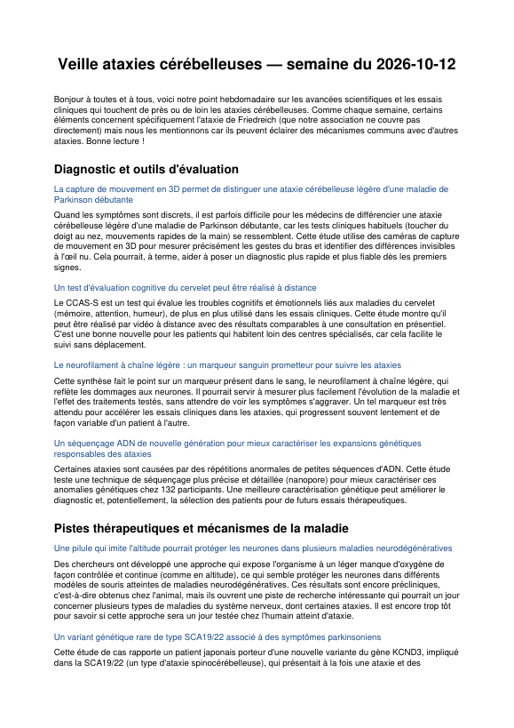

# Ataxia Research Digest

Automated weekly research watch on **cerebellar ataxias** for a French patient association.
Every Monday, a GitHub Actions workflow collects the week's new clinical trials, scientific
papers and news articles, asks Claude to turn them into a plain-language French newsletter,
and publishes it as a PDF.



👉 [Example output (PDF)](docs/sample-digest.pdf)

## Why

Families and patients want to know what's new in research, but the sources are scattered,
technical and in English. This pipeline does the monitoring and the translation into
accessible French, with strict rules against inventing anything: every item links back to
its original source.

## How it works

```
PubMed              ─┐
ClinicalTrials.gov  ─┼─► dedup (seen_ids.json) ─► Claude, structured tool call ─► validation ─► PDF
Google News (FR)    ─┘
```

| Step | Module | Details |
|---|---|---|
| Collect | `src/collectors/` | PubMed E-utilities (esearch + efetch), ClinicalTrials.gov API v2 with pagination, Google News RSS with French search terms |
| Deduplicate | `src/state.py` | Only items never reported before are kept; state is committed back to the repo by the workflow |
| Summarize | `src/summarize.py` | Claude is forced to call a `build_digest` tool, so the answer comes back as structured JSON; the output is validated before rendering, with clear errors on truncated or malformed responses |
| Render | `src/pdf.py` | ReportLab PDF with clickable titles; only `http(s)` links are kept |

The scope of the watch (diseases, look-back window, news language) lives in
[`config/sources.yaml`](config/sources.yaml) and can be changed without touching the code.

## Run it locally

```bash
python -m venv .venv && source .venv/bin/activate
pip install -r requirements.txt
cp .env.example .env   # then add your ANTHROPIC_API_KEY
python -m src.main
```

The PDF is written to `output/digest-YYYY-MM-DD.pdf`. If nothing new was found, no PDF is produced.

## Deployment

[`.github/workflows/weekly_digest.yml`](.github/workflows/weekly_digest.yml) runs every Monday
at 07:00 UTC and can be triggered manually from the Actions tab. Add `ANTHROPIC_API_KEY`
(and optionally `NCBI_API_KEY`) under *Settings → Secrets and variables → Actions*.
Each run uploads the PDF as a workflow artifact and commits the updated `seen_ids.json`.

## Stack

Python 3.12 · Anthropic API (tool use) · requests · feedparser · ReportLab · GitHub Actions

## License

MIT — see [LICENSE](LICENSE).
